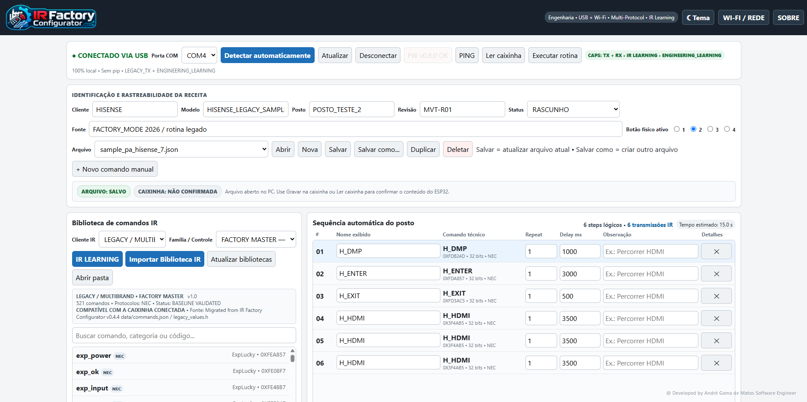
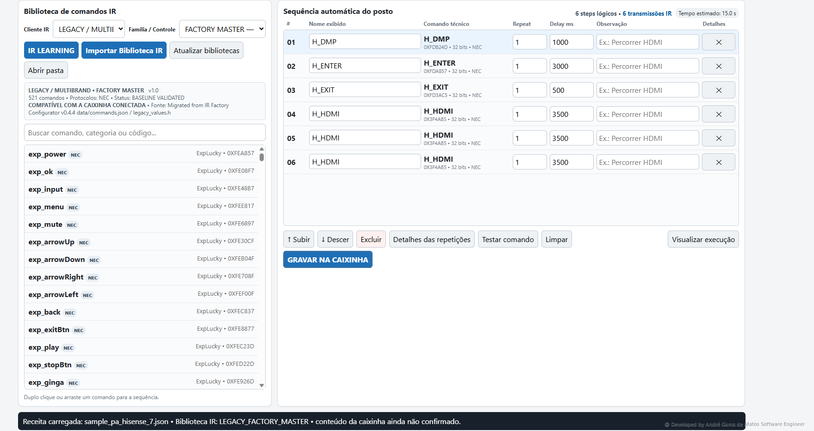
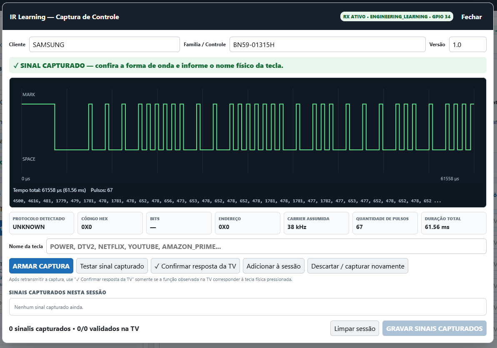
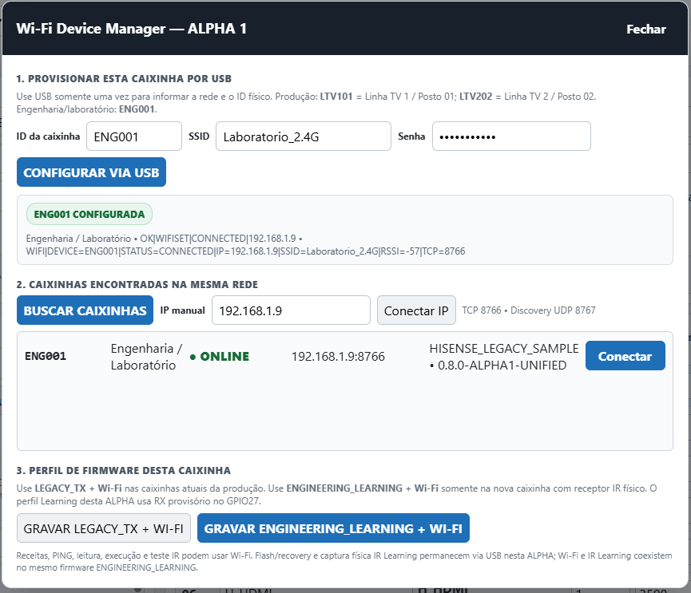
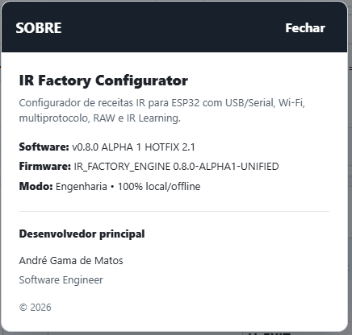

# IR Factory Configurator

Industrial engineering software for configuring, managing, validating, and deploying infrared (IR) test sequences to ESP32-based factory devices used in electronics manufacturing environments.

## System Preview

*Main engineering interface showing recipe identification, IR command library, station sequence configuration, and ESP32 communication controls.*

## Overview

**IR Factory Configurator** is an industrial engineering tool designed to simplify the configuration and maintenance of infrared test routines used in electronics manufacturing.

The project replaces direct source-code editing of legacy IR sequences with a configurable architecture based on **IR command libraries**, **station recipes**, and **ESP32-based execution devices**.

The system combines a Python local server, a web-based engineering interface, ESP32 firmware, USB/Serial communication, Wi-Fi connectivity, multi-protocol infrared transmission, RAW IR support, and IR Learning capabilities.

The project was developed using **Python and C++**, combining embedded systems, industrial test automation, infrared communication, hardware–software integration, and engineering configuration management.

## Main Features

- Creation and management of IR test recipes
- Configurable station sequences
- Multi-client IR command libraries
- Multi-protocol infrared transmission
- RAW IR waveform support
- IR Learning using a physical infrared receiver
- IR signal capture, decoding, validation, and library generation
- USB/Serial communication with ESP32 devices
- Wi-Fi device discovery and remote communication
- Device identification for production and engineering units
- Automatic serial device detection
- Firmware compatibility checking
- Device recovery and firmware update workflow
- Recipe synchronization status between PC and ESP32
- Physical button selection for factory devices
- Command repetition and configurable execution delays
- Recipe metadata and engineering traceability
- Light and dark user-interface themes
- Local/offline engineering operation
- Production-oriented configuration workflow

## Recipe Management and IR Command Library

*IR command library and station sequence editor, showing reusable commands, logical steps, repeat controls, execution delays, and recipe deployment to the ESP32 device.*

The system uses structured IR libraries organized by client and remote-control family.

Each library can contain protocol information, command identifiers, hexadecimal codes, RAW waveforms, validation metadata, and technical source information.

Portable IR library packages can be imported into the application, allowing validated IR command sets to be reused without modifying the main application source code.

## IR Learning

*Captured infrared waveform during the IR Learning workflow, including pulse count, total duration, assumed carrier frequency, and signal metadata.*

The IR Learning workflow allows an engineering device equipped with an infrared receiver to capture physical remote-control signals.

The workflow supports:

- Physical IR signal capture
- Protocol detection
- HEX code identification
- Bit-length identification
- RAW waveform preservation
- Signal retransmission
- Validation on the target television
- Naming and organization of captured keys
- Generation of reusable IR libraries

This architecture allows new remote-control families to be incorporated without modifying the core application.

## Wi-Fi Device Management

*Wi-Fi Device Manager used for provisioning, device discovery, network status verification, and connection to engineering or production ESP32 devices.*

The application supports both USB/Serial and Wi-Fi communication.

Production and engineering devices can be provisioned with unique identifiers, discovered on the local network, and accessed remotely for compatible engineering operations.

USB remains available for device recovery, firmware flashing, and workflows that require direct physical access.

## System Architecture

The IR Factory Configurator architecture combines:

**Embedded Layer**
- ESP32 microcontroller
- Infrared transmitter
- Physical station buttons
- Status LED
- Optional infrared receiver for IR Learning
- Embedded firmware developed in C++

**Communication Layer**
- USB/Serial communication
- Wi-Fi communication
- Local network device discovery
- Structured command and status protocol
- Automatic serial device detection
- Device identity and capability reporting

**Application Layer**
- Python local server
- Web-based engineering interface
- IR command library management
- Recipe creation and editing
- Recipe synchronization and deployment
- Wi-Fi device management
- IR Learning workflow
- Firmware recovery and update support

## Technologies

- Python
- C++
- ESP32
- Arduino Framework
- PlatformIO
- HTML
- CSS
- JavaScript
- USB/Serial Communication
- Wi-Fi
- Infrared Communication
- Multi-Protocol IR
- RAW IR
- Embedded Systems
- Industrial Test Automation
- Industrial Automation
- Hardware–Software Integration

## About

*Product identification, software version, firmware version, operating mode, and developer attribution.*

## Intellectual Property

The IR Factory Configurator is registered as a computer program with the Brazilian National Institute of Industrial Property (**INPI**).

**Registration number:** BR512026008468-7  
**Certificate issued:** 6 October 2026  
**Creation date:** 11 September 2026  
**Title:** IR Factory Configurator  
**Rights holder:** André Gama de Matos  
**Authors:** André Gama de Matos and André Logan Almeida de Matos  
**Registered languages:** C++, JavaScript and Python  
**Registration authority:** INPI, Brazil

**Note:** The INPI registration and the Zenodo DOI have distinct purposes: the registration identifies the protected computer program, while the DOI provides a persistent citation identifier for the public archival record. The public technical showcase is not necessarily identical to the private registered source-code archive.

## Project Status

**Functional engineering release – validated with real ESP32 hardware and production-oriented IR workflows.**

Current frozen reference version:

**v0.8.0 ALPHA 1 HOTFIX 2.1** (internal validated baseline; public archival tag: `v0.8.0-alpha.1`)

The current implementation includes configurable recipes, multi-client IR libraries, USB/Serial and Wi-Fi communication, multi-protocol transmission, RAW IR, IR Learning, device recovery, recipe synchronization, and engineering traceability.

## Repository Scope

This repository is intended as a **technical portfolio and project documentation repository**.

The public repository may include technical documentation, architecture descriptions, screenshots, release information, citation metadata, and selected non-confidential project materials.

The complete production source code, customer-specific recipes, proprietary IR command libraries, credentials, manufacturing configurations, and confidential implementation details are not required to be publicly distributed through this repository.

## Authors

**André Gama de Matos**  
Software Engineer  
Embedded Systems | Test Automation | Industrial Electronics | Infrared Systems | Industrial Automation

**André Logan Almeida de Matos**  
Co-author

## Citation

If you reference the IR Factory Configurator in technical, academic, or research work, please cite:

**Matos, André Gama de; Matos, André Logan Almeida de. (2026). IR Factory Configurator (v0.8.0-alpha.1) [Software documentation]. Zenodo. https://doi.org/10.5281/zenodo.23270719**

## DOI / Zenodo

**DOI:** https://doi.org/10.5281/zenodo.23270719

## License and Intellectual Property Notice

Copyright © 2026 André Gama de Matos and André Logan Almeida de Matos.

The IR Factory Configurator is an original registered software project published here as a controlled technical showcase.

The availability of technical documentation in this repository does not imply authorization to reproduce, commercialize, redistribute, reverse engineer, or create derivative implementations of the protected software, firmware, proprietary IR libraries, or manufacturing configurations.

Any public release should exclude confidential customer information, production credentials, proprietary command databases, and restricted manufacturing data.

## Publication and Reuse

This public repository provides project documentation and approved non-confidential materials. No open-source license is granted for the proprietary application source code or firmware. Any separately published documentation or assets retain their respective rights notices unless an explicit license states otherwise. For permissions and reuse requests, contact the rights holder.
